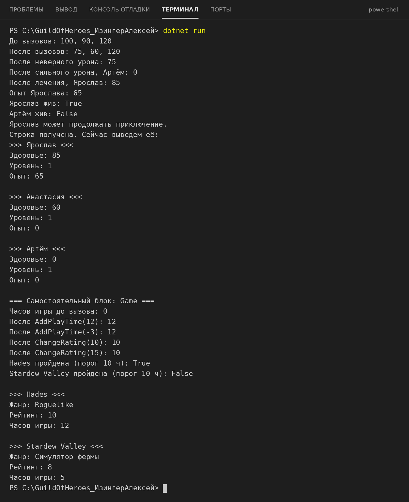
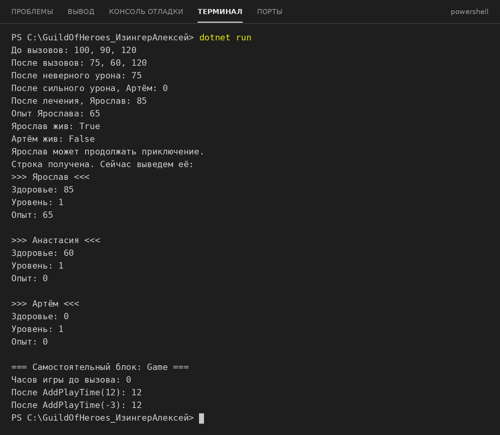

# Практическая работа № 10

Учебный консольный проект на C#: гильдия героев.

Автор: Изингер Алексей, группа ИСП-242.

## Приложение 

- класс `Hero` с полями `Name`, `Health`, `Level`, `Experience` и конструктором `Hero(string name, int health)`;
- в `Program.cs` создаются три независимых героя: Ярослав (100), Анастасия (90), Артём (120).

### Методы класса Hero

Добавлены пять методов экземпляра: `TakeDamage(int damage)`, `Heal(int amount)`, `GainExperience(int amount)`, `IsAlive()` и `GetInfo()`.

- Недопустимый урон проверен вызовом `yaroslav.TakeDamage(-20)`: сработал ранний `return;`, здоровье Ярослава осталось `75`. Урон `200` для Артёма остановил здоровье на `0`, а не на `-80`.
- Итог запуска: Ярослав — здоровье `85`, опыт `65`, жив (`True`); Анастасия — здоровье `60`, опыт `0`, жива (`True`); Артём — здоровье `0`, опыт `0`, мёртв (`False`). Уровень у всех `1`.
- Поля пока открыты: запись `yaroslav.Health = -5000` проходит мимо проверок (выведено `-5000`). Защитой состояния займёмся в ПР №3.

### Самостоятельный шаг: действие класса Game (этап 9)

Предметная область — игры (`Game.cs`: поля `Title`, `Genre`, `Rating`, `HoursPlayed`).

- Добавлено действие: `AddPlayTime(int hours)` — добавляет часы игры.
- Параметр `hours` получает количество сыгранных часов; значение прибавляется к `HoursPlayed` той игры, у которой вызван метод.
- Проверен отказ: `AddPlayTime(-3)` отклонён ранним `return;`. Наблюдаемые значения: до вызова `0`, после `AddPlayTime(12)` — `12`, после `AddPlayTime(-3)` — `12`.

### Поведение главного класса

Метод 1: `AddPlayTime(int hours)`
Что делает: увеличивает `HoursPlayed` на переданное число часов; ноль и отрицательные значения отклоняет.

Метод 2: `ChangeRating(int newRating)`
Что делает: заменяет `Rating` новой оценкой, если она лежит в диапазоне от 1 до 10; иначе оценка остаётся прежней (`ChangeRating(15)` у Hades оставил `10`).

Метод 3: `IsFinished(int hoursToFinish)`
Что возвращает: `bool` — `true`, если `HoursPlayed` не меньше порога `hoursToFinish`. Результат зависит и от состояния объекта, и от параметра: для Hades (12 ч) при пороге 10 — `True`, для Stardew Valley (5 ч) — `False`.

Почему эти действия относятся именно к этому классу:
Игра сама хранит свои часы и оценку, поэтому и правила обращения с ними живут рядом с данными: время нельзя «отыграть» назад отрицательным числом, а оценка по десятибалльной шкале не может выходить за её границы. Вопрос «пройдена ли игра» тоже решается по собственному состоянию игры (сколько в неё сыграно), а не по данным внешнего кода. Независимость объектов проверена: `AddPlayTime` и `ChangeRating` у Hades не изменили Stardew Valley (`5` часов и рейтинг `8` остались своими).

## Скриншоты 

